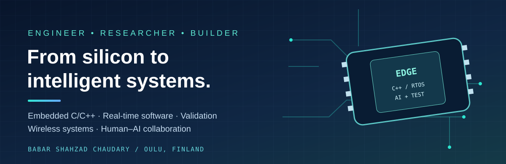
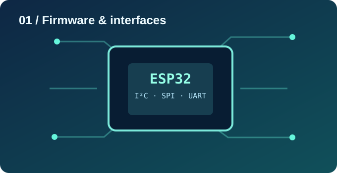
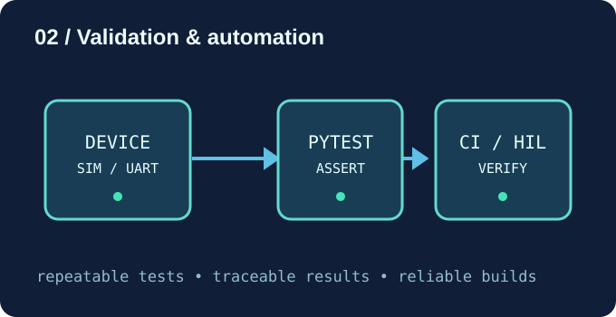

# Hi, I'm Babar 👋
**Babar Shahzad Chaudary, PhD** · Embedded Software Engineer & Researcher · Oulu, Finland

*I make the connection between low-level hardware, dependable software, and intelligent systems.*

[Explore my projects](https://github.com/babarcha?tab=repositories) · [Research & engineering](#03--humanai-systems--research) · [Connect](#get-in-touch)

---

## A career built across layers

I began by understanding how software meets physical systems, went deep into performance-critical **5G/LTE physical-layer software**, and continue to explore reliable **embedded platforms** and **cooperative human–AI systems**. What connects these chapters is a fascination with turning complicated technology into systems people can actually depend on.

### 01 / Embedded firmware — close to the hardware

An embedded system is only as dependable as the interface between its software and hardware. My [ESP32 Hardware Interface Labs](https://github.com/babarcha/esp32-hardware-interface-labs) explore **UART, I²C, SPI and CAN/TWAI** through modular ESP-IDF drivers, bus abstractions, native tests and reproducible builds.

The same low-level thinking connects to my earlier work on **real-time 5G/LTE L1 PHY software**, where C/C++, signal processing, debugging and performance constraints matter.

### 02 / Verification — proving that software works

I treat validation as part of engineering, not something added at the end. My [Embedded Validation Platform](https://github.com/babarcha/embedded-validation-platform) explores reusable Python test tooling, simulated versus physical devices, serial protocols, pytest and automated CI. Hardware-in-the-loop is an extension of that approach, with actual device testing distinguished from simulation.

**Explore related builds:** [FreeRTOS modular labs](https://github.com/babarcha/esp32-freertos-modular-labs) · [Raspberry Pi Embedded Linux](https://github.com/babarcha/rpi4-embedded-linux-modular-labs)

### 03 / Human–AI systems & research

My research asks a practical question: **how can humans and intelligent systems cooperate reliably when physical-world assistance is at stake?**

My PhD at the **University of Oulu** investigated ICT-supported telepresence and navigation for people with visual impairment. Current research interests extend into **Human-in-the-Loop AI**, adaptive assistance, intelligent edge systems, trustworthy handover and digital health.

> **From sensing and connectivity to decisions and human agency:** reliable systems should explain what they do, adapt to context and keep people meaningfully involved.

---

## Selected engineering projects

<table>
<tr>
<td width="50%" valign="top"><strong><a href="https://github.com/babarcha/esp32-hardware-interface-labs">Hardware Interface Labs</a></strong> UART • I²C • SPI • CAN/TWAI</td>
<td width="50%" valign="top"><strong><a href="https://github.com/babarcha/embedded-validation-platform">Embedded Validation Platform</a></strong> Python • pytest • simulation • CI</td>
</tr>
<tr>
<td valign="top"><strong><a href="https://github.com/babarcha/esp32-freertos-modular-labs">FreeRTOS Modular Labs →</a></strong> Task scheduling, synchronization and real-time design</td>
<td valign="top"><strong><a href="https://github.com/babarcha/rpi4-embedded-linux-modular-labs">Embedded Linux Labs →</a></strong> Raspberry Pi, C++ and modular Linux applications</td>
</tr>
<tr>
<td valign="top"><strong><a href="https://github.com/babarcha/ElevatorSimu">Elevator Simulation →</a></strong> Software modeling and simulation</td>
<td valign="top"><strong><a href="https://github.com/babarcha/CppVehicleManager">C++ Vehicle Manager →</a></strong> Object-oriented programming practice</td>
</tr>
</table>

## My engineering toolkit

**Firmware:** C/C++, STM32, ESP32, ARM Cortex, FreeRTOS, bare-metal, UART, I²C, SPI, CAN/TWAI

**Systems:** Embedded Linux, Yocto, CMake, Ninja, Git, Docker, 5G/LTE L1 PHY

**Verification:** Python, pytest, Robot Framework, unit and integration testing, simulation, CI, HIL validation

**Research:** Edge AI, assistive navigation, digital health, human–AI cooperation

## How I build

[Hardware labs CI](https://github.com/babarcha/esp32-hardware-interface-labs/actions) · [Validation platform CI](https://github.com/babarcha/embedded-validation-platform/actions)

## Get in touch

I'm interested in collaborations connecting **embedded engineering**, **reliable AI**, and **human-centered systems**.

[Browse my GitHub repositories →](https://github.com/babarcha?tab=repositories)

Illustrations are original conceptual graphics, not photographs of specific hardware or testing setups.
